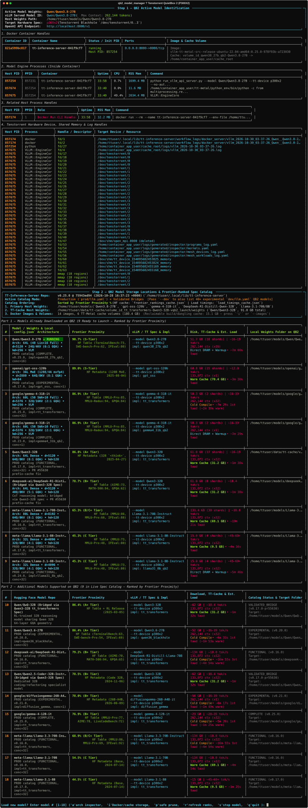

# tt-qb2-model-manager

**Unified Model Manager, Frontier Proximity Ranker, and Deterministic Bring-Up Monitor for the Tenstorrent QuietBox 2 (`P300X2`)**

`tt-qb2-model-manager` ([`qb2_model_manager.py`](./qb2_model_manager.py)) is a fast, zero-GUI-dependency CLI and interactive terminal appliance manager purpose-built for the **Tenstorrent QuietBox 2** (`P300X2` — 4× `p300c` PCIe boards / 8× Blackhole ASICs / 128 GB GDDR6).

It unifies deep hardware/container forensics, an automated **Hugging Face Frontier Proximity %** benchmark ranker, local `.safetensors` and `config.json` architecture inspection, `tt-metal` warm/cold cache analysis, safe multi-chip resets (`tt-smi -r`), and a deterministic 5-phase bring-up progress tracker into a single command (`./qb2_model_manager`).

<p align="center">
  
</p>

---

## Key Features

### 1. Deep QuietBox 2 Process, Container & Hardware Handle Forensics (Step 1)
Every invocation begins by inspecting the live state of the QuietBox 2 across Docker, the host Linux kernel, and the 4 Blackhole PCIe device nodes:
* **Container & Engine Identification:** Inspects running `tt-inference-server-*` containers (`docker ps`, `docker inspect`, `docker top`) and queries `/health` and `/v1/models` on port `8000`.
* **Bridged Weight Detection:** Inspects Docker bind mounts (`--mount type=bind,src=...,dst=.../readonly_weights_mount`) so architecturally bridged models are reported by their true weights identity (e.g., **`deepseek-ai/DeepSeek-R1-Distill-Qwen-32B` (served via vLLM spec: `Qwen/Qwen3-32B`)**) rather than just the vLLM spec alias.
* **Host Process Classification:** Distinguishes between container-internal processes (`VLLM::EngineCore`, `APIServer`), host launch wrappers (`run.py`, `tail -f vllm_*.log`), and external inference clients (such as `cjllm.py`), protecting external client harnesses during model switches.
* **Kernel & Device Handle Auditing (`/proc/<pid>/fd` & `/proc/<pid>/maps`):** Audits every process holding `/dev/tenstorrent/0..3`, `/dev/hugepages-1G` (`tt_hugepage_*`), and `/dev/shm` (`tt_umd_*`) to detect stale `tt-smi` sessions or orphaned locks before launching a new model.

---

### 2. Pure-Python Hugging Face Frontier Proximity % Ranker & Tier Classification (Step 2)
Instead of listing models alphabetically, `qb2_model_manager.py` ranks every downloaded and supported model from **highest Frontier Proximity % (`100%` = current open-weights frontier ceiling) to lowest**:
* **Automated Benchmark Harvesting:** Queries the Hugging Face Hub REST API and parses model card Markdown/HTML benchmark tables across 7 core capability categories:
  * **Reasoning (`GPQA` / `GPQA-Diamond`)** · **Coding (`LiveCodeBench`)** · **Math (`AIME` / `MATH-500`)** · **Knowledge (`MMLU-Pro` / `MMLU`)** · **Agentic (`Terminal-Bench` / `SWE-bench` / `BFCL` / `TAU-Bench`)**
* **Architecture & Scale Bonuses:** Accounts for parameter scale, MoE active-parameter efficiency, native context length (up to `262K`), and reasoning/thinking post-training.
* **Offline-First Caching:** Persists harvested scores in [`frontier_rankings_cache.json`](./frontier_rankings_cache.json) for instant (`<100 ms`) startup and supports live re-harvesting via `--refresh-ranks` or interactive `'r'`.

| Tier | Score Range | Meaning on QuietBox 2 (`P300X2`) | Example Models |
| :--- | :--- | :--- | :--- |
| **`S-Tier`** | **`>= 88.0%`** | Near-frontier reasoning, coding & agentic performance | `Qwen/Qwen3.8-27B` (`97.5%`), `Qwen/Qwen3.6-27B` (`97.5%`), `openai/gpt-oss-120b` (`92.4%`), `Qwen/Qwen3-32B` (`88.9%`), `google/gemma-4-31B-it` (`88.9%`) |
| **`A+ Tier`** | **`80.0% – 87.9%`** | Strong reasoning, math & code generation | `deepseek-ai/DeepSeek-R1-Distill-Qwen-32B` (`85.9%`), `Qwen/QwQ-32B` (`84.2%`), `DeepSeek-R1-Distill-Llama-70B` (`83.6%`), `Llama-3.3-70B-Instruct` (`81.8%`) |
| **`A Tier`** | **`72.0% – 79.9%`** | Capable general-purpose & specialist models | `Qwen/Qwen2.5-Coder-32B-Instruct` (`78.8%`), `meta-llama/Llama-3.1-70B-Instruct` (`76.1%`) |
| **`B+ Tier`** | **`64.0% – 71.9%`** | Fast mid-size / compact instruction models | `meta-llama/Llama-3.1-8B-Instruct` (`64.2%`) |
| **`B / C+ / C`** | **`< 64.0%`** | Base pretrained checkpoints or narrow task models | `Llama-3.1-70B` (base), `Llama-3.1-8B` (base) |

---

### 3. Authoritative YAML Spec Discovery & Validated 32B Architectural Bridges
* **Direct YAML Catalog Parsing:** Reads `/home/ttuser/.local/lib/tt-inference-server/workflows/model_specs/prod/llm.yaml` (and `dev/llm.yaml` + `dev/vlm.yaml` with `--dev`), preserving multiple engine implementations per model (`tt-transformers` vs. `tt-forge-vllm`).
* **Multi-Root Weight Discovery:** Scans `/home/ttuser/models/<org>/<repo>`, `/home/ttuser/data/tt-cache/volume_id_*/weights/*`, and custom local `.safetensors` directories, verifying that all shards are complete (no `.incomplete` files) and automatically passing `--host-weights-dir` to `run.py`.
* **Validated 32B Architectural Bridges:** Enables `P300X2` execution for **64-layer, 5120-hidden, 40Q/8KV GQA** models (`deepseek-ai/DeepSeek-R1-Distill-Qwen-32B`, `Qwen/QwQ-32B`, `Qwen/Qwen2.5-Coder-32B-Instruct`) using the `Qwen/Qwen3-32B` `p300x2` TT-Metal mesh specification.
* **Automatic PR `#55630` Patch Injection:** Automatically injects the local `0.17.0-8c48a10-f52987a-pr55630` Docker image when launching `Qwen3-32B` and its bridged 32B models to prevent prefix-caching slot collision crashes.

---

### 4. Local `config.json` Architecture & Shard Inspector (`--arch` / `'a'`)
* **Inline Catalog Column:** Displays a compact architecture summary directly in **Part 1 (Downloaded Models)**:
  * Example: `64L · 40Q/8KV · 128K ctx · bf16 · 17 shards` or `64L · 24Q/4KV · 262K ctx · bf16 · 18 shards`
* **Deep Architecture Inspector (`--arch [N]` or `'a [N]'`):** Prints a detailed breakdown parsed directly from each downloaded model's local `config.json` and `.safetensors` directory:
  * `model_type` & `architectures` class
  * Layers, `hidden_size`, `intermediate_size`, and `head_dim`
  * Attention topology (`num_attention_heads`, `num_key_value_heads`, GQA ratio, and hybrid linear-attention conv/key/value head dims for `qwen3_5_text` / `Qwen3.8`)
  * MoE topology (`num_local_experts`, `num_experts_per_tok` for `gpt-oss-120b` and `gemma4`)
  * Native `max_position_embeddings`, RoPE `rope_theta`, `vocab_size`, `torch_dtype`, and `.safetensors` shard count.

---

### 5. Warm/Cold TT-Metal Cache Detector & Persistent Load-Time Estimator
* **Warm vs. Cold `.tensorbin` Inspection:** Inspects `/home/ttuser/data/tt-cache/volume_id_tt_transformers-*-<Model>/tensor_cache_*` (and `/home/ttuser/tt_cache`) for compiled `.tensorbin` artifacts before launch:
  * **`🔥 WARM (<size> GB, ~Xm Ys)`:** Compiled tensor cache exists on disk; startup reuses cached tensor layout.
  * **`❄️ COLD (~Xm Ys)`:** First boot or direct-DRAM upload architecture; full weight conversion/upload required.
* **Persistent Rolling-Median Timing Cache ([`load_timings_cache.json`](./load_timings_cache.json)):** Automatically records every successful warm and cold bring-up duration on the QuietBox 2 and computes rolling median ETAs for both the catalog table and the live Stage 4 countdown timer.

---

### 6. 5-Stage Automated Model Switcher & Deterministic 5-Phase Bring-Up Tracker
Selecting a model number executes a clean, automated 5-stage pipeline:
1. **Stage 1 — Graceful Takedown:** Stops any running `tt-inference-server-*` container, terminates orphaned host `run.py` / `tail -f` wrappers, and closes stale background `tt-smi` sessions.
2. **Stage 2 — Hardware Mesh Reset (`tt-smi -r`):** Automatically locates a working `tt-smi` binary inside `.workflow_venvs/.venv_tt_smi/bin/tt-smi` (avoiding broken system Python installs), verifies all `/dev/tenstorrent/0..3` handles are free, and resets all 4 Blackhole PCIe boards.
3. **Stage 3 — Weight Verification / Auto-Pull & Container Launch:** Verifies local `.safetensors` shards (or downloads them via `huggingface_hub` if selecting from Part 2), launches `run.py`, and **immediately hands off to Stage 4** the instant the Docker container is created.
4. **Stage 4 — Deterministic 5-Phase Bring-Up & Trace-Capture Progress (`StartupProgressTracker`):**
   * **`[Phase 1/5]`** Container Environment, Venv & Python Runtime Init
   * **`[Phase 2/5]`** Blackhole `(1, 4)` Mesh Discovery, Firmware Init & `FABRIC_1D_RING` Bring-Up
   * **`[Phase 3/5]`** `.safetensors` Shard Loading & Tensor Cache / DRAM Upload — combines container stdout parsing with **live host `/proc/<EngineCore_pid>/maps` memory-map polling** so even silent `safetensors.safe_open` loaders (like `Qwen3.8-27B`) emit deterministic shard badges (`[Weights Shard: 1/18 (6%)]` → `18/18 (100%)`).
   * **`[Phase 4/5]`** Paged KV Cache Allocation (`1,051,104 tokens`), `riscv-tt-elf-g++` Kernel Compilation counters (`50 / 100 / 150` kernels), `tt_transformers` warmup, and `prompt_client` 11-step trace capture (`[Trace 1/11: seq_len=128]` → `[Trace 11/11: seq_len=130,944]`).
   * **`[Phase 5/5]`** FastAPI `/health` `200 OK` & `/v1/models` Endpoint Verification
5. **Stage 5 — End-to-End Inference Smoke Test:** Sends a live `/v1/chat/completions` test prompt to verify Tensix token generation and prints latency + token usage before exiting.

---

### 7. Docker Image & TT-Metal Cache Volume Storage Inspector / Pruner (`--images`, `--prune`)
* Inspects all local `ghcr.io/tenstorrent/tt-inference-server/*` Docker images (tag, image ID, age, size, and whether currently in use by a container or referenced by a catalog spec).
* Inspects all compiled TT-Metal tensor cache volumes (`volume_id_tt_transformers-*`) and `/home/ttuser/tt_cache` directories with exact disk usage and `.tensorbin` file counts.
* Provides safe, interactive or CLI-driven cleanup (`--prune` or `'p'`) for dangling Docker layers, unused image tags, or specific model tensor caches without touching `.safetensors` weights.

---

## Usage & Interactive Commands

### CLI Flags
```bash
./qb2_model_manager                  # Interactive status + Frontier-ranked catalog + switcher
./qb2_model_manager --dev            # Include all experimental dev/llm.yaml + dev/vlm.yaml QB2 models
./qb2_model_manager --status         # Show active model status + ranked catalog and exit
./qb2_model_manager --select 1       # Switch directly to model #1
./qb2_model_manager --stop           # Gracefully stop active model + run tt-smi -r and exit
./qb2_model_manager --refresh-ranks  # Force re-harvesting benchmark tables from Hugging Face Hub
./qb2_model_manager --arch           # Inspect local config.json architecture for all downloaded models
./qb2_model_manager --arch 1         # Inspect local config.json architecture for model #1
./qb2_model_manager --images         # Inspect Docker images & TT-Metal cache disk usage (--storage)
./qb2_model_manager --prune          # Interactively prune unused Docker images or TT-Metal caches
```

### Interactive Prompt Commands (`Load new model?`)
* **`1`..`N`** — Select a model by its catalog `#` (if already running, exits cleanly; otherwise stops current model, runs `tt-smi -r`, pulls weights if needed, launches, and streams 5-phase readiness).
* **`a` / `a <N>`** — Open the `config.json` Architecture & Shard Inspector (for all downloaded models or model `#N`).
* **`i`** — Open the Docker Image & TT-Metal Cache Volume Storage Inspector.
* **`p`** — Open the interactive Docker Image & TT-Metal Cache Pruner.
* **`r`** — Refresh Frontier Proximity % rankings live from Hugging Face Hub.
* **`s` / `stop`** — Gracefully stop the currently running model, run `tt-smi -r`, and exit.
* **`q` / `Enter`** — Quit without disturbing the running model.

---

## Comparison with `tsingletaryTT/tt-model-runner`

`tt-qb2-model-manager` was independently designed and built from the ground up for headless/SSH operation on the QuietBox 2 (`P300X2`). Another project in the Tenstorrent community, [`tsingletaryTT/tt-model-runner`](https://github.com/tsingletaryTT/tt-model-runner) (`tt-model-runner-gui`), provides a multi-board GTK 4 desktop GUI and Textual TUI for running Tenstorrent workloads.

During later development, we reviewed `tt-model-runner` to compare design philosophies and adapted several operational ideas (such as persistent warm/cold load-time estimation, inline `config.json` architecture inspection, and Docker image inspection) into our native QuietBox 2 implementation.

### Architectural & Capability Differences

| Capability | `tt-qb2-model-manager` (This Repo) | [`tsingletaryTT/tt-model-runner`](https://github.com/tsingletaryTT/tt-model-runner) |
| :--- | :--- | :--- |
| **Origin & Architecture** | Independently developed, single-file CLI + `rich` terminal manager ([`qb2_model_manager.py`](./qb2_model_manager.py)) with zero GUI dependencies; runs instantly over SSH (`<100 ms`) | Multi-module desktop application (`~30` files) built around `AppController` with **GTK 4 GUI** (`./run`) and **Textual TUI** (`./run --tui`) front-ends |
| **Target Hardware** | Purpose-built for **QuietBox 2 (`P300X2`, 4× `p300c` / 8× Blackhole ASICs)** | General-purpose across `N150`, `N300`, `T3K`, `P100`, `P150`, `P300`, `P300X2`, and `GALAXY` |
| **Model Ranking & Ordering** | **Frontier Proximity % Ranker (`S-Tier` → `C-Tier`):** Harvests `GPQA`, `LiveCodeBench`, `AIME`, `MMLU-Pro`, `Terminal-Bench`, `SWE-bench`, and `MATH-500` from Hugging Face Hub and orders models from strongest to weakest | **Alphabetical Family Tree:** Groups models alphabetically by family (`Llama`, `Qwen`, `Gemma`) and task chips with no benchmark or quality ranking |
| **Catalog Source of Truth** | **Authoritative YAML Specs (`workflows/model_specs/{prod,dev}/*.yaml`):** Parses `prod/llm.yaml`, `dev/llm.yaml`, and `dev/vlm.yaml` directly (**29 `P300X2` LLM/VLM configs**, preserving multiple engine implementations like `tt-transformers` vs. `tt-forge-vllm`) | **Static `model_spec.json` Export + `compatibility.json`:** Reads `model_spec.json` (which only exports `prod` specs — **13 `P300X2` LLMs**, omitting all `dev/*.yaml` specs) and keeps only the first implementation in `impl_map` |
| **Weight Storage Discovery** | Scans `/home/ttuser/models/<org>/<repo>`, `/home/ttuser/data/tt-cache/volume_id_*/weights/*`, and custom local `.safetensors` folders; verifies shard completeness and passes `--host-weights-dir` automatically | Scans only `~/.cache/huggingface/hub/models--*/snapshots`; marks models stored in `/home/ttuser/models` or `/home/ttuser/data/tt-cache` as uncached unless manually configured |
| **Architectural Bridges & Patched Images** | Built-in support for **32B architectural bridges** (`DeepSeek-R1-Distill-Qwen-32B`, `QwQ-32B`, `Qwen2.5-Coder-32B-Instruct` via `Qwen3-32B` spec), automatic **PR `#55630`** image injection, and bind-mount inspection so bridged models are identified by their true weights | Identifies running servers solely via `/v1/models` against `model_spec.json` (misidentifying bridged models as `Qwen3-32B`) and does not support cross-repo architectural bridges |
| **Hardware Reset & Process Forensics** | Deep `/proc/<pid>/fd` & `/proc/<pid>/maps` auditing of `/dev/tenstorrent/0..3`, `/dev/hugepages-1G`, and `/dev/shm`; automatically closes stale `tt-smi` processes, resolves the working `.venv_tt_smi/bin/tt-smi` binary, and runs `tt-smi -r` on every model switch | Calls bare `tt-smi` on `$PATH` (which fails on QB2 if `/usr/bin/tt-smi` lacks `tt_umd`) and stops containers via `docker stop` without verifying `/dev/tenstorrent/*` release or running an automatic `tt-smi -r` reset between switches |
| **Bring-Up Progress Tracking** | **5-Phase `StartupProgressTracker` + Host `/proc/<pid>/maps` Shard Poller:** Streams live progress across both `v0.17.0` (`prompt_client` 11-trace capture) and `v0.25.0` (`qwen38_27b_qb2` silent `safetensors.safe_open` 18-shard mmap upload + `riscv-tt-elf-g++` kernel compile counters + 16-occupancy prefill warmup) | Log-line regex parser for `tqdm` weight bars and 10-step trace capture (`128..65408`), plus rotating educational "Did you know?" cards |
| **Built-In Benchmarking & Tool-Call UI** | Runs an automated Stage 5 `/v1/chat/completions` readiness smoke test on bring-up (external benchmarking handled by `cjllm-search-harness`) | Includes interactive GUI/TUI tabs for `run.py --workflow benchmarks` sweeps and multi-turn HTTP tool-call testing |
